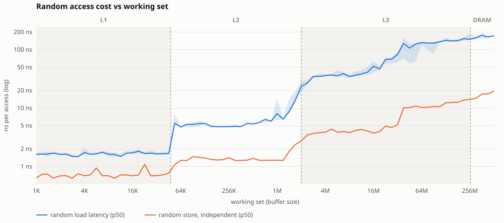

# os-latency-tests

Measures operating system and hardware latencies from user space and reports
them as full distributions (p50, p90, p99, p99.9, p99.99, max), together with a
description of the platform they were measured on.

## At a glance

One `./run-all.sh` on a 4-vCPU cloud VM (Xeon, 48 KiB L1, 2 MiB L2, 260 MiB L3)
produced this chart and ten more ([full sample report](docs/sample-report/report.md)):

[](docs/sample-report/report.md#memory)

What it tells you about that machine, in its own numbers:

- A random access that misses every cache costs **175x an L1 hit** (292 ns vs
  1.67 ns): keep the data a hot loop touches under ~36 KiB per core.
- Handing a value to another thread through a lock-free SPSC ring takes
  **387 ns, 35x faster** than a mutex + condvar queue (13.4 us), at the price
  of a core spinning while it waits.
- Starting a thread costs 6.7 us typically but **79 us at p99**: reuse threads
  from a pool instead of spawning per task.
- A `std::pmr::monotonic_buffer_resource` arena builds a `std::list`
  **4.2x cheaper** than new/delete.

[Full report](docs/sample-report/report.md) ·
[interactive HTML version](https://htmlpreview.github.io/?https://github.com/ionutneicu/os-latency-tests/blob/main/docs/sample-report/report.html)
(hover for exact values) · run it on your machine: [Quick start](#quick-start)

> [!WARNING]
> **Hot path only.** The techniques these benchmarks justify (spinning instead of
> blocking, lock-free queues, pinning, cache-sized buffers, arenas, branchless
> code, platform intrinsics) trade readability, maintainability and portability
> for nanoseconds. Apply them only to the measured hot path of ultra-low-latency
> or high-performance code, after a profiler has shown that path matters, and
> keep everything else simple and portable. Re-measure on each target platform:
> what wins on one CPU can lose on another.

The goal is to compare kernels (generic, low-latency, `PREEMPT_RT`) and boards,
and to back low-latency / HPC design decisions with data for a given platform:
reuse threads or spawn them, block or spin, allocate per operation or keep
buffers, size working sets to fit a cache level, and so on.

Supported today: **Linux on x86-64 and AArch64**. Everything platform specific
sits behind a small hardware abstraction layer (see [Architecture](#architecture)),
so other architectures and operating systems can be added without touching the
benchmarks.

What each benchmark measures and how to apply its result in C++, with code:
[docs/benchmarks/](docs/benchmarks/README.md). Plans and next measurements: [docs/ROADMAP.md](docs/ROADMAP.md). Tuning
beyond a stock kernel (isolated cores, PREEMPT_RT, boot options, kernel
bypass), with what to expect: [docs/expert-setup.md](docs/expert-setup.md).
Terms used in the reports (cache line, TLB, AVX-512, read for ownership, p99,
SCHED_FIFO, ...) are explained in [docs/GLOSSARY.md](docs/GLOSSARY.md).

## Prerequisites

| What | Why | Debian/Ubuntu | Fedora | Arch |
|---|---|---|---|---|
| C/C++ compiler (GCC >= 8 or Clang >= 7), make | build the benchmark | `build-essential` | `gcc-c++ make` | `base-devel` |
| CMake >= 3.16 | build system | `cmake` | `cmake` | `cmake` |
| Linux kernel headers | perf counters (optional, auto-detected) | `linux-libc-dev` | `kernel-headers` | `linux-api-headers` |
| Python >= 3.9 (standard library only) | HTML report and SVG charts | `python3` | `python3` | `python` |
| sudo / root | optional: RT priority, `mlockall`, blocking deep idle | | | |

```sh
# Debian / Ubuntu
sudo apt install build-essential cmake linux-libc-dev python3
# Fedora
sudo dnf install gcc-c++ make cmake kernel-headers python3
# Arch
sudo pacman -S base-devel cmake linux-api-headers python
```

Check with `python3 --version` (3.9 or newer) and `cmake --version` (3.16 or
newer). No Python packages are needed for the report.

**Conda (optional).** If you prefer to get CMake, Ninja and Python (plus NumPy,
pandas, Matplotlib and JupyterLab for your own analysis) from conda, install
[Miniforge](https://github.com/conda-forge/miniforge) and create the bundled
environment. The C/C++ compiler still comes from the system packages above,
because the toolchain and C library are part of what is measured:

```sh
curl -LO https://github.com/conda-forge/miniforge/releases/latest/download/Miniforge3-Linux-$(uname -m).sh
bash Miniforge3-Linux-$(uname -m).sh       # follow the prompts, then open a new shell
conda env create -f environment.yml
conda activate olt                          # then use ./run-all.sh as below
```

See [With conda](#with-conda) for a full conda-based walkthrough.

## Quick start

One command builds, runs every benchmark and opens the report (install the
[prerequisites](#prerequisites) first):

```sh
./run-all.sh            # full run, asks for sudo (RT priority, mlock, deep idle blocked)
./run-all.sh --quick    # ~20 s smoke run; --no-sudo for an unprivileged run
./run-all.sh -y         # never stop to ask when pre-flight checks warn (scripts, cron)
```

Results go to `results/<host>-<timestamp>/`: `report.html`, the same report as
`report.md` (renders on GitHub/GitLab, handy for sharing), every chart as a
standalone SVG in `charts/`, `results.json` and raw samples in `raw/`.

Step by step:

```sh
cmake -S . -B build
cmake --build build -j
./build/os-latency-tests                       # all benchmarks, about a minute
python3 tools/olt-report.py olt-results/results.json   # -> olt-results/report.html + report.md
```

Open `olt-results/report.html` in a browser for the graphs.

Benchmark an optimised build only. The default build type is RelWithDebInfo
(`-O2 -g`). Without optimisation the timed loops measure the compiler's stack
traffic, not the hardware, and results come out up to several times too slow.
CMake warns when the flags have no optimisation level. It also repairs a known
trap: a configure that ran before `g++` was installed caches empty C++ flags,
and later configures used to keep them and build the C++ code at `-O0`. The
benchmark binary checks this too: it shows `optimised` on its `build` line,
warns before running if it is not, and the report then marks the results as not
valid.

### With conda

If you prefer a conda environment for the tools (CMake, Ninja, Python and the
analysis stack), use the bundled `environment.yml`. The compiler and C library
still come from the system on purpose, because they are part of what is
measured:

```sh
sudo apt install build-essential linux-libc-dev   # system compiler + headers
conda env create -f environment.yml               # once
conda activate olt
cmake -S . -B build -G Ninja && cmake --build build
sudo ./build/os-latency-tests -p 80 -m --no-idle  # results stay owned by you
python tools/olt-report.py olt-results/results.json
```

The environment also has NumPy, pandas, Matplotlib and JupyterLab for going
beyond the HTML report, for example:

```python
import json, pandas as pd
res = json.load(open("olt-results/results.json"))
mutex = pd.read_csv("olt-results/raw/sync.mutex_wakeup.csv")
print(mutex["ns"].describe(percentiles=[.5, .9, .99, .999]))
```

Update it after `environment.yml` changes with `conda env update -f environment.yml --prune`.

For trustworthy tail latencies run with real-time scheduling and locked memory:

```sh
sudo ./build/os-latency-tests --rt-prio 80 --mlock --samples 100000
```

On laptops and boards with power management, blocking wake-ups are often
dominated by the sleeping core leaving a deep idle state and by the frequency
governor. Run once as is and once with `--no-idle` (and the `performance`
governor) to see both sides.

Example console output (x86-64 VM, trimmed):

```
benchmark                                         n       min       p50       p90       p99     p99.9    p99.99       max
-------------------------------------------------------------------------------------------------------------------------
sync.mutex_wakeup                              2000   9.32 us   53.7 us    141 us    462 us  ~3.97 ms  ~6.10 ms   6.17 ms
thread.create_to_start                         2000   4.56 us   7.64 us   11.4 us   66.5 us   ~396 us   ~466 us    476 us
```

A `~` marks a percentile with fewer than ~10 samples beyond it. Such values are
not statistically reliable; increase `--samples` (p99.9 needs 10 000 samples,
p99.99 needs 100 000).

## Command line

| Option | Description |
|---|---|
| `-l, --list` | list benchmarks and exit |
| `-t, --test PATTERN` | run benchmarks matching a glob (`sync.*`) or substring; repeatable, default all |
| `-n, --samples N` | measured samples per benchmark (default 10000) |
| `-w, --warmup N` | discarded warm-up iterations (default 100) |
| `-a, --affinity MODE` | `none`, `same` (both threads on one CPU) or `different` (two CPUs, default) |
| `--cpus MAIN[,WORKER]` | pin to explicit CPUs instead of the automatic choice (highest-numbered allowed CPUs, away from CPU 0's interrupt load) |
| `-p, --rt-prio N` | run benchmark threads as `SCHED_FIFO` priority N (root or `CAP_SYS_NICE`) |
| `-m, --mlock` | `mlockall()` to avoid page-fault latency |
| `--no-idle` | keep the benchmark CPUs out of deep idle (C-)states for the run (root): only states that wake as fast as C1 stay allowed. Set per CPU through `pm_qos_resume_latency_us`, so other CPUs keep sleeping and the old values come back at exit; where that is not available, for all CPUs through `/dev/cpu_dma_latency`. Compare with and without to see how much wake-up latency comes from idle exit |
| `--idle-latency-us N` | with `--no-idle`, allow idle states that wake within N µs instead (implies `--no-idle`). `0` allows only polling: idle benchmark CPUs spin, which costs turbo headroom on power-limited CPUs and execution resources of the SMT sibling |
| `--cpu-warmup-ms N` | busy-spin the main and worker CPUs for N ms before each benchmark so frequency scaling has ramped up (default 200, 0 = off) |
| `--park-us N` | how long a signalling thread waits so its peer is really blocked in the kernel (default 200) |
| `--mem-min BYTES`, `--mem-max BYTES` | buffer size range of the memory sweep (default 1K to 4x the largest cache, max 512M and RAM/4; `K`/`M`/`G` suffixes) |
| `--sweep-steps N` | buffer sizes per doubling in the memory sweep (default 4) |
| `--sweep-samples N` | samples per buffer size in the memory sweep (default 15) |
| `--hugepages` | back the sweep buffer with transparent huge pages, removing most TLB misses |
| `-o, --out DIR` | output directory (default `olt-results`) |
| `--no-raw` | skip per-sample CSV files |
| `-y, --yes` | run without asking when pre-flight checks warn |

## Output

* **Console**: platform summary and one table row per result.
* **`results.json`** (`schema: olt-results/1`): platform (CPU, board, kernel,
  preemption model, governor, isolated CPUs, cache hierarchy, cycle counter
  frequency, timer overhead, available perf counters, compiler, build type and
  whether the C and C++ code was optimised), run configuration, and
  summary statistics per result: count, min, max, mean, standard deviation,
  median absolute deviation, percentiles, and which percentiles are unreliable.
* **`raw/*.csv`**: every individual sample, for histograms, CDFs and your own
  analysis.

Percentiles use linear interpolation between closest ranks (Hyndman & Fan
type 7, the NumPy/R default).

## HTML report

`tools/olt-report.py` (Python 3 standard library only, so it also runs on the
board) turns a `results.json` into one self-contained HTML file:

* **latency distributions**: a percentile curve (min to p99.99+, from the raw
  samples) per benchmark group, e.g. mutex vs condvar wake-up, thread start vs
  join;
* **malloc/free latency vs block size** (p50 and p99);
* **random load latency vs working-set size** (log scale) and **sequential
  read/write bandwidth vs size**, with the cache sizes reported by the OS drawn
  as bands, so every drop in performance can be matched to the L1/L2/LLC
  capacity it comes from; hover shows each measured point;
* a **per-level summary**: typical latency and bandwidth while the data fits
  each level;
* **design hints** derived from the measurements (e.g. the cost ratio of a
  DRAM miss to an L1 hit and the working-set sizes to aim for);
* a percentile table for every other benchmark.

Under each section, **code links** point to the exact lines that were measured
(one link per variant, e.g. `mutex_condvar` vs `lockfree`), on GitHub at the
commit the binary was built from. They stay correct when the code changes
later, because they never point at `main`. A build with local changes says so
next to the links; a build without git (a source tarball) links to `main`.

Every chart is also written as a standalone SVG file to `charts/` next to the
report, for slides and documents. A Markdown twin, `report.md`, carries the same
text and tables and links those SVGs, so a results directory pushed to GitHub or
GitLab (or pasted into a wiki) reads as a report without opening the HTML. See
[docs/sample-report/](docs/sample-report/report.md) for an example.

```sh
python3 tools/olt-report.py olt-results/results.json -o report.html
```

Installed packages provide it as `olt-report`.

## Benchmarks

| Name | What is measured |
|---|---|
| `thread.create_to_start` | `std::thread` construction until the first instruction of the new thread |
| `thread.exit_to_join` | last instruction of a thread until `join()` returns |
| `sync.mutex_wakeup` | worker `unlock()` until the blocked main thread's `lock()` returns |
| `sync.condvar_wakeup` | worker sets the predicate (then unlocks and `notify_one()`) until `wait()` returns |
| `mem.latency_random` | dependent loads along a random cycle of cache lines (pointer chase) in a buffer of each size: load-to-use latency of the level the working set fits in |
| `mem.read_seq`, `mem.write_seq` | sequential read / write of the same buffer with the widest vectors the CPU has (AVX-512 / AVX2 / SSE2, NEON), cost per cache line (GB/s = line size / value) |
| `mem.write_nt` | sequential non-temporal (streaming) write: stores that bypass the caches, cost per cache line |
| `mem.write_random` | independent 8-byte stores to random cache lines of the buffer: store throughput per level when every miss must fetch its line |
| `multicore.c2c_latency` | one-way cache-line hand-off between every pair of CPUs (atomic ping-pong), drawn as a heatmap |
| `os.call` | ns per raw system call (`syscall(SYS_getpid)`), per `clock_gettime` for each clock (vDSO or system call) and per cycle-counter read (Linux) |
| `os.timer_overshoot` | how late a thread wakes from `nanosleep` (default and 1 ns timer slack), a `timerfd` and `epoll_wait`, for 1 µs to 1 ms requests (Linux) |
| `cpu.branch`, `cpu.branch_sorted` | ns per element of a conditional sum, 0 to 50% of elements passing at random positions or sorted, as a branch, a branchless mask and a ternary: the cost of a mispredict and where branchless code wins (branch misses per element when perf counters are available) |
| `cpu.ilp` | ns per operation with 1 to 16 independent dependency chains (integer multiply, double add/multiply, L1 loads, DRAM loads): how far to unroll and how many cache misses overlap |
| `multicore.false_sharing` | cost per increment when two cores update counters 8 to 512 bytes apart (plain `++` and atomic `fetch_add`), vs one core alone: the padding this CPU needs |
| `pattern.*` | design-pattern comparisons, see [Design patterns](#design-patterns) |
| `alloc.malloc`, `alloc.free` | `malloc()`/`free()` of one block, 16 B to 16 MiB, allocator best case (block reused, memory untouched) |

The memory sweep allocates and pre-faults one buffer up front and reuses
prefixes of it for every size, so page faults never show up in the curves.
By default it uses base pages, so latency past the TLB reach includes page
walks; compare with a `--hugepages` run to separate TLB from cache effects.

Wake-up benchmarks use a persistent worker thread, so thread creation does not
leak into them, and timestamps come from the monotonic clock shared by all CPUs.
Measurements below ~100 ns include the clock read overhead reported in the
platform section.

Planned (see the project plan): thread pool vs spawn vs single thread,
spin/atomic hand-offs, stride and prefetch-distance sweeps, stack copy vs
persistent heap buffers, false sharing, pipes/eventfd/loopback sockets, timer
and sleep jitter, perf counters per benchmark, and more design guidance.

## Design patterns

Benchmarks named `pattern.*` run the same task several ways, so the report can
show which implementation choice wins on a given machine and by how much. They
appear in the report's **Design patterns** section with comparison charts and
in the design hints.

### Container memory (`pattern.alloc_vector`, `pattern.alloc_list`)

Build and destroy a 256-element container, cost per element:

| Variant | What it is | Typical use |
|---|---|---|
| `new_delete` | default `std::allocator` (global `operator new`/`malloc`) | baseline |
| `reserve` (vector only) | `reserve()` before filling: one allocation, no regrowth copies | known or bounded sizes |
| `pmr_monotonic` | `std::pmr::monotonic_buffer_resource` over a stack buffer: bump-pointer allocation, free is a no-op, everything released at once | per-request / per-frame / per-message scratch data |
| `pmr_pool` | `std::pmr::unsynchronized_pool_resource` kept alive: recycled fixed-size blocks, single-threaded | long-lived containers with churn, one thread |

Node-based containers (`std::list`, `std::map`, ...) allocate per element, so
the allocator choice matters far more for them than for `std::vector`.

### Single producer / single consumer (`pattern.spsc_latency`, `pattern.spsc_throughput`)

The same bounded ring of 64-bit items, synchronised five ways:

| Variant | Synchronisation | Waiting consumer |
|---|---|---|
| `mutex_condvar` | `std::mutex` + `std::condition_variable` | sleeps in the kernel |
| `mutex_poll` | `std::mutex`, `try_pop` in a loop | spins (takes the lock each poll) |
| `spinlock` | test-and-test-and-set spinlock on `std::atomic` | spins |
| `lockfree` | lock-free ring, each index on its own cache line, acquire/release | spins on an atomic load |
| `lockfree_cached` | as `lockfree`, plus each side caches the other side's index | spins, touches shared lines only when needed |

Latency is half of a ping-pong round trip through two queues; throughput
streams 256 Ki items through one queue. Each result also records
`metrics.cpu_cores`: CPU time of producer plus consumer divided by wall time
(2.0 = both threads kept a core busy), shown as "CPU cores busy" in the report. The trade-off to read from the results:
polling variants are much faster but keep a core busy, and blocking variants
pay the OS wake-up cost (which grows with deep idle states, see `--no-idle`).
Run with `--affinity same` to see what happens when both threads share a CPU.

### Dispatch (`pattern.dispatch_one_type`, `pattern.dispatch_mixed`)

1024 small objects of four types each compute a one-cycle operation; the
result is ns per call. The same objects are called six ways:

| Variant | How the code is chosen | When |
|---|---|---|
| `virtual` | vtable, `std::unique_ptr<Base>` | run time, open set of types |
| `std_function` | `std::function` holding a small lambda | run time, any callable |
| `function_ptr` | function pointer + state | run time, C interfaces |
| `switch` | enum tag + `switch` | run time, closed set |
| `variant` | `std::variant` + `std::visit` | run time, closed set, objects stored inline |
| `template` | function template per type; mixed objects kept in one vector per type | compile time (templates, CRTP, policy classes) |

`dispatch_one_type` has a single type at the call site, so the branch predictor
always guesses the target; `dispatch_mixed` calls the four types in a new
random order every sample, so it misses most of the time.

## Multicore communication

`multicore.c2c_latency` pins two threads to every pair of allowed CPUs and
ping-pongs one value through a `std::atomic` on its own cache line. The report
draws the one-way latency per pair as a heatmap. It shows the machine's
topology as the software sees it: SMT siblings (shared L1/L2) are fastest,
cores in the same cluster or die next, other clusters (big.LITTLE), CCXs or
sockets slowest. Use it to choose where producer/consumer pairs run, for
example with `--cpus A,B` for the SPSC patterns.

`multicore.false_sharing` answers how far apart data written by different
threads must be. Two threads on different physical cores (never SMT siblings,
which share the L1) each increment their own counter, placed 8 to 512 bytes
apart. Two variants are measured: a plain load + store (a non-atomic `++`,
where the store buffer hides part of the cost) and an atomic `fetch_add` (which
pays every cache-line transfer). The report finds the smallest distance at which
the cost falls back to the single-core figure. On many x86 CPUs that is
128 bytes, not 64, because the adjacent-line prefetcher fetches lines in pairs.
Use that value in `alignas()` for per-thread counters, queue indices and locks.

`multicore.atomic_contention` shows what a shared atomic costs as cores are
added: 1 to N threads, one per physical core, increment one shared
`std::atomic` (`fetch_add`, or a compare-exchange loop with
`metrics.retries`) or one counter per thread (`sharded`), in ns per increment
as each thread sees it. `multicore.atomic_order` measures each memory order on
one core without contention: load, store and `fetch_add` with relaxed,
acquire/release and seq_cst, plus a seq_cst fence.

## Measurement hygiene

Before measuring, pre-flight checks look for conditions that make results
noisy and print a warning for each:

* the CPU frequency governor of the benchmark CPUs is not `performance`;
* the benchmark CPUs (or the whole system) are already busy with other work,
  sampled from `/proc/stat` for 300 ms;
* little memory is available (less than 10% of RAM, or less than the memory
  sweep needs);
* the binary was compiled without optimisation (C++ or C code at `-O0`): its
  numbers describe the compiler, not the machine, and the report marks them as
  not valid.

In an interactive terminal the tool then asks whether to continue anyway;
`--yes` skips the question, and non-interactive runs (scripts, CI) continue.
Warnings are stored in `results.json` and shown at the top of the report.

Before each benchmark the main and worker CPUs are busy-spun for
`--cpu-warmup-ms` (200 ms) so frequency scaling has left its idle clocks, and
every benchmark discards `--warmup` iterations (or a whole first run) before
recording. For the most stable tails also use `--rt-prio`, `--mlock`,
`--no-idle` and the `performance` governor (`./run-all.sh` does all but the
governor).

## Build dependencies

Required:

| Dependency | Version | Debian/Ubuntu package |
|---|---|---|
| C11 and C++17 compiler (GCC or Clang) | GCC >= 8, Clang >= 7 | `g++` or `clang` |
| CMake | >= 3.16 | `cmake` |
| POSIX threads | glibc or musl | part of the C library |

Optional:

| Dependency | Needed for | Debian/Ubuntu package |
|---|---|---|
| Linux UAPI headers (`<linux/perf_event.h>`) | perf counters (`OLT_WITH_PERF`) | `linux-libc-dev` |
| AArch64 cross toolchain | cross-compiling for ARM boards | `g++-aarch64-linux-gnu` |
| Python 3 | `tools/olt-report.py` HTML report | `python3` |
| qemu user emulation | running cross-built tests on the build host | `qemu-user` |
| debhelper, dpkg-dev | building `.deb` packages | `debhelper`, `dpkg-dev` |

There are no runtime dependencies beyond the C and C++ standard libraries.

Optional conda environment for the tools and analysis: see
[Quick start, with conda](#with-conda).

## Build options

Optional features follow one pattern, `OLT_WITH_<FEATURE>=AUTO|ON|OFF`: `AUTO`
enables the feature when its dependencies are found, `ON` fails configuration
if they are missing, and `OFF` builds a stub that reports the feature as
unavailable at run time. This keeps the tool buildable on boards and toolchains
with limited capabilities.

| Option | Default | Description |
|---|---|---|
| `OLT_WITH_PERF` | `AUTO` | hardware/software counters through `perf_event_open()` |
| `OLT_FORCE_GENERIC_ARCH` | `OFF` | use the portable compiler-builtin arch HAL (for bring-up on new CPUs) |
| `OLT_BUILD_TESTS` | `ON` | unit tests and a smoke run, executed with `ctest` |

Even when perf support is compiled in, which counters work depends on the CPU,
the kernel, virtualisation and `/proc/sys/kernel/perf_event_paranoid`. The
platform section shows which ones could be opened. Software counters (context
switches, migrations, page faults) usually work even without a PMU.

## Cross-compiling for ARM

```sh
sudo apt install g++-aarch64-linux-gnu qemu-user
cmake -S . -B build-arm64 -DCMAKE_TOOLCHAIN_FILE=cmake/toolchains/aarch64-linux-gnu.cmake
cmake --build build-arm64 -j
(cd build-arm64 && ctest)          # runs under qemu-aarch64 when installed
scp build-arm64/os-latency-tests board:
```

For other toolchains (Linaro, Yocto/Buildroot SDKs) pass
`-DOLT_CROSS_PREFIX=/path/to/bin/aarch64-none-linux-gnu-`. Numbers measured
under qemu are meaningless; always benchmark on the real board.

## Debian packages

The `debian/` directory builds a native package with debhelper and CMake
(build dependencies are listed in `debian/control`):

```sh
sudo apt install build-essential debhelper dpkg-dev cmake linux-libc-dev
dpkg-buildpackage -us -uc -b
sudo apt install ../os-latency-tests_*.deb
```

Cross-building an arm64 package on an amd64 host needs multiarch:

```sh
sudo dpkg --add-architecture arm64 && sudo apt update
sudo apt install crossbuild-essential-arm64 linux-libc-dev:arm64
dpkg-buildpackage -us -uc -b -aarm64
```

## Architecture

```
include/olt/hal/arch.h        CPU primitives: cycle counter, prefetch (L1/L2/L3/NTA/write),
  arch/x86_64.h               barriers, cpu_relax, cache-line flush, cache-line size
  arch/aarch64.h
  arch/generic.h              compiler-builtin fallback
include/olt/hal/os.h          OS services (C API): monotonic clock, affinity, SCHED_FIFO,
  src/hal/linux/os_linux.c    mlockall, cache topology, CPU/board/kernel/preempt info
include/olt/hal/stream.h      bulk read/write kernels at the CPU's widest vector width
  src/hal/stream.c            (AVX-512 / AVX2 / SSE2 picked at run time, NEON, generic)
include/olt/hal/perf.h        optional counters
  src/hal/linux/perf_linux.c  perf_event_open backend
  src/hal/stub/perf_stub.c    no-counter stub
include/olt/*.hpp, src/core/  C++17 harness: clock calibration, statistics, registry, reports
src/benchmarks/               benchmarks, self-registered with OLT_BENCHMARK(...)
tools/olt-report.py           results.json -> self-contained HTML report
```

The HAL headers are plain C, so they can also be used from C code. To port:

* **New CPU architecture**: add `include/olt/hal/arch/<arch>.h` implementing the
  contract documented in `arch.h` and select it there.
* **New OS**: implement `include/olt/hal/os.h` in `src/hal/<os>/` (and
  optionally `perf.h`), then add it to the HAL selection in `CMakeLists.txt`.

## Adding a benchmark

```cpp
#include "olt/benchmark.hpp"

OLT_BENCHMARK("mem.example", "What is measured, precisely")
{
    ctx.add_result("mem.example", {{"size", "4K"}}, ctx.run_samples([&] {
        const uint64_t t0 = olt::now_ns();
        // ... operation under test ...
        return static_cast<double>(olt::now_ns() - t0);
    }));
}
```

Add the file to the `os-latency-tests` target in `CMakeLists.txt`.
Then add a page to [docs/benchmarks/](docs/benchmarks/README.md) (goal, what
is measured, how to read the result, how to apply it in C++) and link it from
the report section with `guide_link()` in `tools/olt-report.py`, passing the
section's results so the report links their code. Each result links to its
`OLT_BENCHMARK` line by default; when a benchmark compares variants, point each
result at its variant's code:

```cpp
struct LockFreeQueue {
    static constexpr olt::SourceLine source = OLT_HERE;  // this line
    // ...
};
ctx.add_result("pattern.spsc_latency", {{"queue", "lockfree"}}, std::move(samples));
ctx.results().back().source = LockFreeQueue::source;
```
