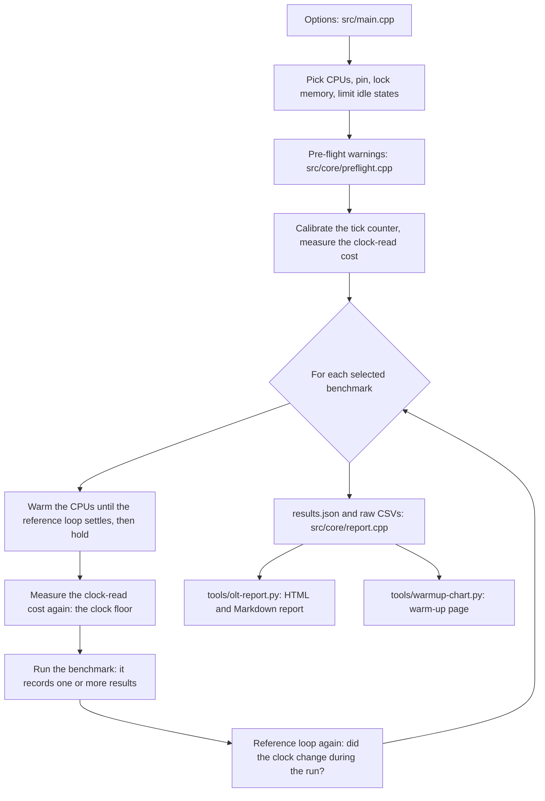

# Architecture

How the pieces of this suite fit together, and which piece owns which decision.
Read this before changing the engine, a shared helper or the output format.

Other documents answer other questions:

| Question | Document |
|---|---|
| How do I run it and read the output? | [README](../README.md) |
| What must a benchmark satisfy before its numbers are shown? | [REQUIREMENTS](REQUIREMENTS.md) |
| What else is affected when I change this part? | [DEPENDENCIES](DEPENDENCIES.md) |
| What does this result mean, and how do I apply it? | [benchmarks/](benchmarks/README.md) |
| What comes next? | [ROADMAP](ROADMAP.md) |

Parts that are agreed but not built yet are marked **planned**, with their issue.

## 1. Overview

`run-all.sh` builds, runs the executable and then runs the report script.

## 2. Layers

Each layer may use the layers above it in this table, never the ones below.

| Layer | Where | Owns | Rule |
|---|---|---|---|
| HAL | `include/olt/hal/`, `src/hal/` | OS calls, cycle counters, intrinsics, assembly, perf counters | Plain C. The only place for non-portable code ([REQUIREMENTS](REQUIREMENTS.md) section 1, enforced by the `hal_scope` test). |
| Engine | `include/olt/*.hpp`, `src/core/`, `src/main.cpp` | Registry, `Context`, timing, warm-up, calibration, pre-flight, statistics, output | Owns measurement policy: how a sample is timed, when the CPU counts as warm, what "at floor" means. |
| Shared helpers | `src/benchmarks/*_util.hpp` | Code that a group of benchmarks shares | Header-only. Every helper and its users are listed in [DEPENDENCIES](DEPENDENCIES.md). |
| Benchmarks | `src/benchmarks/*.cpp` | The work under test, and its self-checks | One `OLT_BENCHMARK` per question. No measurement policy of its own. |
| Output tools | `tools/` | Charts, tables, design hints | Python standard library only. Read `results.json`, never the executable. |

### HAL

- `arch.h` selects `arch/x86_64.h`, `arch/aarch64.h` or `arch/generic.h` (`OLT_FORCE_GENERIC_ARCH`).
- `os.h` is implemented in `src/hal/linux/os_linux.c`: pinning, priorities, idle limits, topology, the OS clock, page-aligned buffers.
- `perf.h` is optional (`OLT_WITH_PERF`): `src/hal/linux/perf_linux.c` or `src/hal/stub/perf_stub.c`.
- `stream.h` holds the sequential read and write kernels (`src/hal/stream.c`).

Optional features follow one pattern: `OLT_WITH_<FEATURE>` = `AUTO`, `ON` or `OFF`.

### Engine

| Part | Files | What it does |
|---|---|---|
| Clock | `clock.hpp`, `src/core/clock.cpp` | `now_ns`, tick calibration, clock-read cost, the settle rule and hold time of the warm-up |
| Registry and context | `benchmark.hpp`, `src/core/benchmark.cpp` | `OLT_BENCHMARK`, `Config`, `Context`, `Result`, `run_samples`, `time_each`, `time_batch`, `warm_cpus`, `clock_check` |
| Statistics | `stats.hpp`, `src/core/stats.cpp` | Percentiles and the summary of each result |
| Platform | `platform.hpp`, `src/core/platform.cpp` | CPU model, caches, governor, kernel, build flags |
| Pre-flight | `preflight.hpp`, `src/core/preflight.cpp` | Warnings about conditions that make results noisy |
| Output | `report.hpp`, `src/core/report.cpp` | Console table, `results.json`, raw CSVs |

`olt_core` is a static library, so `tests/unit_tests.cpp` tests the engine without running benchmarks.

## 3. Lifecycle of one measurement

Who decides what. This is the place to read before touching timing.

| Step | Owner | What happens |
|---|---|---|
| Choose CPUs | `main.cpp` `resolve_cpus` | Main and worker CPU from `--cpus` or `--affinity`. The highest allowed CPUs are preferred, because CPU 0 serves more interrupts. |
| Run conditions | `main.cpp` `apply_main_thread_settings` | `mlockall`, idle-state limit on the benchmark CPUs, pinning, `SCHED_FIFO`. |
| Calibration | `calibrate_ticks`, `measure_timer_overhead` | Once per run. |
| Warm-up | `Context::warm_cpus` | A reference loop (a dependent multiply chain) runs on the main and the worker CPU. Warm means the last 5 windows agree within 3%. Then it holds for twice the ramp, at least 50 ms, within `--cpu-warmup-ms`. |
| Clock floor | `main.cpp`, `Context::set_clock_floor_ns` | The cost of one clock-read pair, measured again after each warm-up. |
| Timing | the benchmark, through the engine | `time_batch`: one clock pair around n calls, for typical cost. `time_each`: one clock pair per call, for tails. `run_samples`: the callback times itself (older benchmarks). |
| At floor | `Context::add_timed_result` | A per-call result whose median is under 3 times the clock floor is marked `at_floor`. It is not a measurement. Batch results are never marked. Results that declare no operation count are not checked. |
| Clock check | `Context::clock_check` | The reference loop again after the benchmark, stored as `reference_after_ns`. |
| Summary and output | `summarize`, `write_json` | Percentiles per result, then `results.json`. |

**Planned**: all benchmarks move to `time_batch` or `time_each`, so no benchmark times itself (#33). A benchmark declares the CPUs it uses, and only those are warmed (#39). Confidence levels from named checks (#33). Run tiers (#34). Run conditions watched during the run, with the start-up checks as the first entries of one condition table (#48). Repeated runs compared per percentile (#47).

## 4. Data contract: `results.json`

`results.json` is the only interface between the executable and the tools.
`"schema": "olt-results/1"` names its version.

| Field | Meaning |
|---|---|
| `platform` | Machine, kernel, caches, clock calibration, build flags |
| `config` | The options of the run, as applied |
| `warnings` | Pre-flight warnings the run started with |
| `warmups[]` | Per benchmark: `ran`, `stable`, `ramp_ms`, `total_ms`, `reference_ns`, and the `trace` of `[ms, ns]` pairs |
| `results[].name` | The result name. One benchmark may record several (see the table in [DEPENDENCIES](DEPENDENCIES.md)). |
| `results[].params` | Parameter values, for example `size=4K` |
| `results[].unit` | Unit of the samples, `ns` unless stated |
| `results[].ops_per_sample` | `1` = per call, `n` = batch of n calls, `null` = not declared |
| `results[].at_floor` | Present and true when a per-call result sits at the clock-read cost |
| `results[].metrics` | Extra figures per result, for example `warmup_ramp_ms`, `reference_after_ns` |
| `results[].source` | File and line of the measured code, for the report's links |

Rules:

- The report script matches results **by name and by parameter keys**. Renaming a result or a parameter removes its section from the report without an error. Change both sides in the same PR.
- New fields are optional for readers. `tools/olt-report.py` must render an older file that lacks them; `tests/report_fixtures.py` checks this with a recorded run.
- A change that breaks old readers needs a new schema version.

## 5. Adding or changing a benchmark

1. Check the benchmark against [REQUIREMENTS](REQUIREMENTS.md).
2. Look up every part you touch in [DEPENDENCIES](DEPENDENCIES.md), and re-run the benchmarks listed against it.
3. Add the source file to the `os-latency-tests` target in `CMakeLists.txt`.
4. Add or update the guide page in `docs/benchmarks/` and its row in `docs/benchmarks/README.md`.
5. Add or update the report section in `tools/olt-report.py`, with `guide_link()`.
6. Add the benchmark, and any new shared helper or cross-reference, to [DEPENDENCIES](DEPENDENCIES.md). The `dependency_map` test fails until every benchmark and helper is named there.
7. Update `tests/fixtures/report-results.json` when the report needs the new results to be tested.

## 6. Decisions and why

Short records, so these are not argued again without new evidence.

| Date | Decision | Why | Issue |
|---|---|---|---|
| 2026-10-25 | Measure through plain C++; assembly only in the HAL | The reader must be able to reproduce a result from the source | REQUIREMENTS section 1 |
| 2026-11-06 | No clock subtraction | Subtracting the clock-read cost from a sample gave wrong answers. Short operations are timed in batches instead. | #33, #42 |
| 2026-11-06 | Batch timing for typical cost, per-call timing for tails only | A per-call sample near the clock-read cost measures the clock | #42 |
| 2026-11-06 | Timing belongs to the engine | One implementation of the timing rules, one place to fix them | #33 |
| 2026-11-06 | Google Benchmark only as an optional cross-check | The suite must show full distributions and control its own run conditions | #33 |
| 2026-11-07 | Warm-up is measured, not a fixed time | The ramp depends on the governor: about 20 ms under powersave, none under performance | #39 |
| 2026-11-07 | Single core by default; warm only the CPUs a test uses | Each busy core lowers the turbo limit of the others | #39 |
| 2026-11-15 | Harness memory (samples, slot tables) stays off the malloc heap | A free block next to the test doubled a 4 KiB malloc and free, from 14 ns to 28 ns | #35 |
| 2026-11-15 | Allocation tests stay separate and share one core, `alloc_util.hpp` (**planned**) | Each answers its own question; the same malloc in the same heap state must give the same number in every section | #35, #36, #45 |

## 7. Keeping this document true

- A PR that changes what a layer owns, the lifecycle above or the `results.json` fields updates this file in the same PR.
- This file describes structure and rules. Details that change often belong in code comments.
