# Latency report

Intel(R) Xeon(R) Processor @ 2.10GHz · x86_64 · Linux 6.18.44-fc-v140 [PREEMPT_DYNAMIC]

| | |
|---|---|
| CPUs | 4 online |
| Data caches | L1 48 KiB, 12-way, per core; L2 2 MiB, 16-way, per core; L3 260 MiB, 20-way, shared by CPUs 0-3 |
| Cache line | 64 B |
| Memory | 15.7 GiB |
| Huge pages | THP madvise; sweep used base pages |
| Power | governor n/a, cpuidle none, deep idle blocked during run |
| Perf counters | linux-perf_event: context_switches, cpu_migrations, page_faults |
| Run | 10000 samples, affinity different (CPU 3/2), RT priority 80, mlock on |
| Compiler | gcc 13.3.0 (RelWithDebInfo) |

> [!WARNING]
> Hot path only: the techniques these results justify (spinning instead of blocking, lock-free queues, pinning, cache-sized buffers, arenas, branchless code, intrinsics) trade readability, maintainability and portability for nanoseconds. Apply them only to the measured hot path of ultra-low-latency or high-performance code, after profiling shows it matters, and keep the rest simple and portable. The numbers are for this machine; re-measure on each target.

- [Design hints for this machine](#hints)
- [Memory hierarchy](#memory)
- [Instruction-level parallelism](#cpu)
- [Blocking wake-up latency](#sync)
- [Thread lifecycle](#thread)
- [Heap allocator](#alloc)
- [Multicore communication](#multicore)
- [Design patterns](#patterns)
- [All latency results](#table)

## Design hints for this machine

- A random access that misses all caches costs about 103x an L1 hit (169 ns vs 1.64 ns). Keep the data a hot loop touches under ~36 KiB per core where possible.
- Working sets up to ~1.5 MiB still get L2 latency (5.38 ns): size per-thread buffers, lookup tables and queues to fit there.
- Beyond the last cache, sequential reads cost 6.92 ns per 64-byte line vs 169 ns per random access: prefer contiguous arrays and streaming over pointer-heavy structures.
- A store that misses to DRAM costs 18.5 ns of throughput vs 169 ns for a dependent load: the store buffer lets the core move on and overlaps the misses. Scattered writes (histograms, scatter, logging) hurt far less than scattered reads; what stalls is reading the data back or filling the store buffer.
- Writing a buffer larger than the last cache: streaming (non-temporal) stores reach 18 GB/s vs 6.93 GB/s for normal stores, which first read each line in. Use them for large output written once and not read again soon (_mm_stream_si128 / stnp, or a memcpy/memset that switches to them).
- A blocking hand-off (mutex/condvar wake-up) costs 30 us typically and 102 us at p99: avoid blocking on the critical path below that budget.
- Starting a thread costs 7.33 us typically but 100 us at p99 (max 2.02 ms): reuse threads from a pool instead of spawning per task.
- Loop unrolling: a floating-point sum with one accumulator runs at 0.589 ns per add (the add latency); with 4 independent accumulators it reaches 0.15 ns (3.9x). Split reductions into 4 partial sums (the compiler does it for integers, for floating point only with -ffast-math / -fassociative-math).
- Memory-level parallelism: one chain of dependent DRAM misses costs 190 ns per load, but 12 independent chains overlap to 15.2 ns (13x). Batch independent lookups (hash probes, tree searches, pointer chasing) 12 at a time, or prefetch ahead, instead of finishing one before starting the next.
- Thread-to-thread hand-off: a blocking mutex+condvar queue takes 11.8 us (p99 26.7 us), a polling lock-free SPSC ring 219 ns (p99 276 ns): 54x faster, at the price of a core spinning while it waits. Give each polling thread its own core.
- Streaming between two threads: lockfree moves 65.5 M items/s, 15.5x more than mutex_poll.
- Node-based containers: a std::pmr::monotonic_buffer_resource arena makes building a list 3.2x cheaper than new/delete (9.41 ns vs 30.5 ns per node). Use arenas for short-lived, per-request or per-frame data that is freed all at once.
- std::vector: reserve() up front saves 28% of the build cost by avoiding regrowth copies.

## Memory hierarchy

Dependent loads in random order through a buffer of the given size, so hardware prefetchers cannot help. Each step up is the working set spilling out of a cache level; dashed lines are the cache sizes reported by the OS. Band: min to p90 across samples. Second line: independent stores to random lines of the same buffer. A store miss does not stall the core (the store buffer holds it while the line is fetched), so misses overlap and a store costs far less than a dependent load at every level.

> Base pages were used, so latency past the TLB reach also includes page walks. Re-run with `--hugepages` to separate TLB misses from cache misses.

Sequential read and write over the same buffer with 16-byte vector loads and stores: prefetchers are effective, so the drops are smaller than for random access and show each level's bandwidth. A normal store must first read its line in, so each written line crosses the bus twice: read for ownership, then write-back. Dashed curve: streaming (non-temporal) stores, which skip that read and the caches: slow while the data would fit in cache, faster beyond it. AVX2/AVX-512 code moves up to 2-4x more per cycle in L1 and L2.

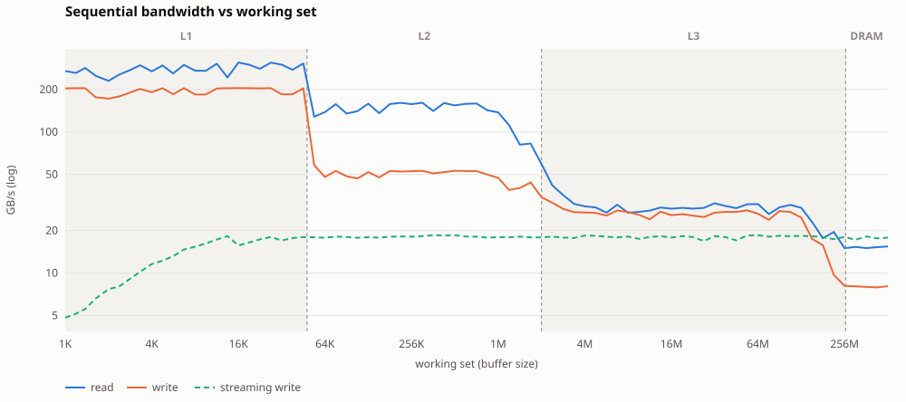

### Per-level summary

| data fits in | sizes used | random load | random store | seq read | seq write | streaming write |
|---|---|---|---|---|---|---|
| L1 | up to 36 KiB | 1.64 ns | 0.695 ns | 88.5 GB/s | 90.1 GB/s | 12.5 GB/s |
| L2 | 72 KiB – 1.5 MiB | 5.38 ns | 1.29 ns | 77.2 GB/s | 49.3 GB/s | 18.1 GB/s |
| L3 | 3 MiB – 195 MiB | 68.4 ns | 4.78 ns | 31.3 GB/s | 26.1 GB/s | 18.1 GB/s |
| DRAM | > 390 MiB | 169 ns | 18.5 ns | 9.25 GB/s | 6.93 GB/s | 18 GB/s |

Benchmark guide: [memory hierarchy](https://github.com/ionutneicu/os-latency-tests/blob/main/docs/benchmarks/memory.md), what is measured and how to apply the result in C++.

## Instruction-level parallelism

A loop runs N independent dependency chains of the same operation (N accumulators, N pointer chases). With one chain every step waits for the previous result, so it runs at the operation's latency; with more chains the out-of-order core overlaps them until an execution port, the load units or the miss buffers are saturated. Where a curve flattens is how far to unroll such a loop on this core. Dashed: perfect overlap.

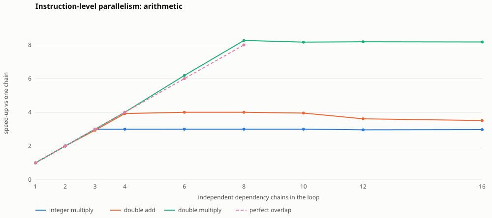

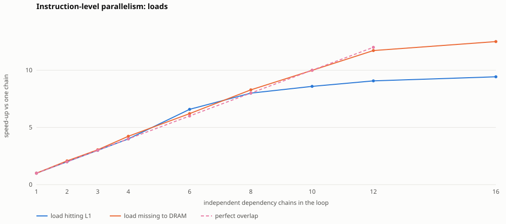

| operation | one chain (latency) | best per op | speed-up | chains to get 90% of it |
|---|---|---|---|---|
| integer multiply | 0.883 ns | 0.294 ns | 3.0x | 3 |
| double add | 0.589 ns | 0.15 ns | 3.9x | 4 |
| double multiply | 1.29 ns | 0.163 ns | 7.9x | 8 |
| load hitting L1 | 1.61 ns | 0.171 ns | 9.4x | 10 |
| load missing to DRAM | 190 ns | 15.2 ns | 12.5x | 12 |

> Curves can drop again at high chain counts: once accumulators outnumber the registers (16 general-purpose and 16 vector registers on x86-64, 32 of each on AArch64) the compiler spills them to the stack. More chains is not always better.

Benchmark guide: [instruction-level parallelism](https://github.com/ionutneicu/os-latency-tests/blob/main/docs/benchmarks/ilp.md), what is measured and how to apply the result in C++.

## Blocking wake-up latency

Time from one thread releasing a mutex / signalling a condition variable to the blocked thread running again. The curve reads left to right from the fastest sample to the tail: the further right it rises, the rarer but costlier the outliers. Percentiles with fewer than ~10 samples beyond them are not drawn.

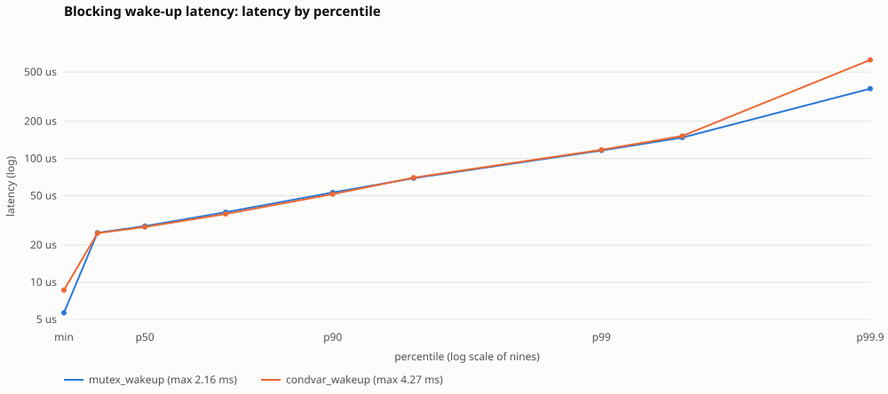

Benchmark guide: [blocking wake-up](https://github.com/ionutneicu/os-latency-tests/blob/main/docs/benchmarks/sync.md), what is measured and how to apply the result in C++.

## Thread lifecycle

Cost of starting a new thread and of joining a finished one. The curve reads left to right from the fastest sample to the tail: the further right it rises, the rarer but costlier the outliers. Percentiles with fewer than ~10 samples beyond them are not drawn.

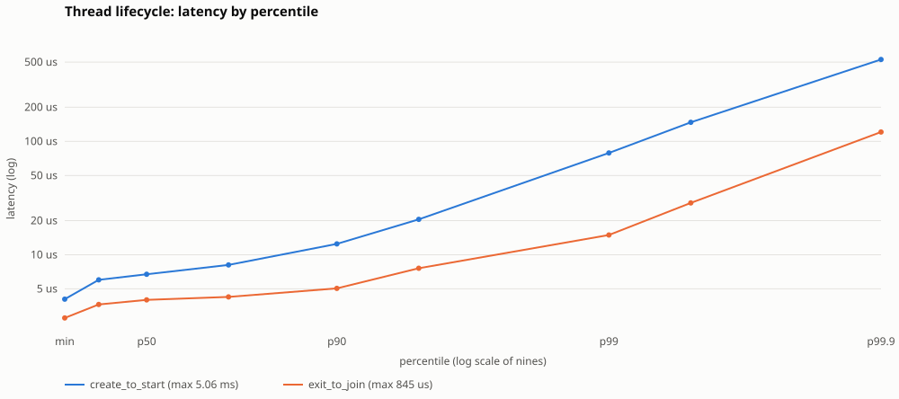

Benchmark guide: [threads: spawn or pool](https://github.com/ionutneicu/os-latency-tests/blob/main/docs/benchmarks/threads.md), what is measured and how to apply the result in C++.

## Heap allocator

Cost of one `malloc()` and one `free()` per block size, in the allocator's best case (the block is reused every iteration and never touched). Solid: p50, dashed: p99.

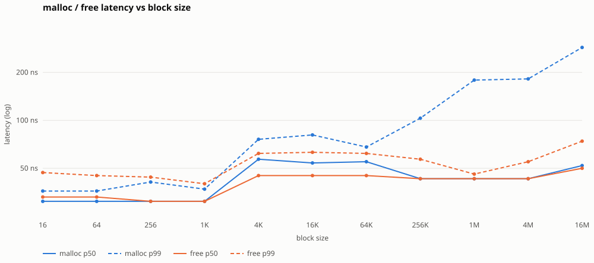

Benchmark guide: [heap allocator](https://github.com/ionutneicu/os-latency-tests/blob/main/docs/benchmarks/alloc.md), what is measured and how to apply the result in C++.

## Multicore communication

Two threads pinned to a pair of CPUs ping-pong one value through a `std::atomic` on its own cache line; each cell is the one-way hand-off latency (half a round trip, p50). This is the floor for any inter-thread communication between those CPUs: SMT siblings share L1/L2 and are fastest, other cores on the same die or cluster come next, other clusters, CCXs or sockets are slowest.

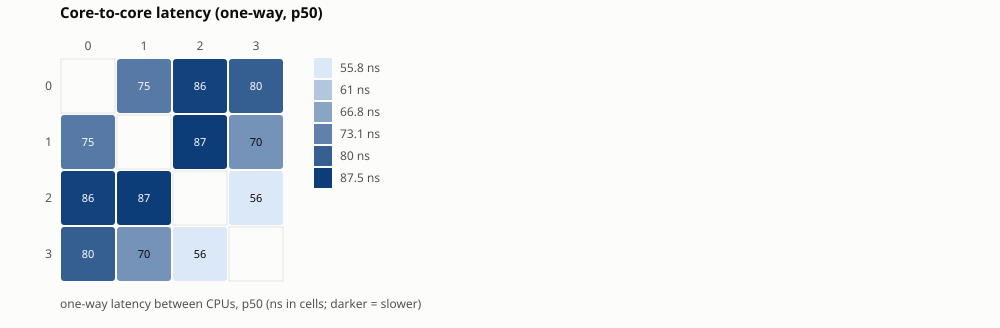

> Fastest pair: CPU 0 ↔ 2 (62.6 ns); slowest: CPU 1 ↔ 3 (78.5 ns); median 68.6 ns. Pin threads that talk a lot (producer/consumer pairs) to a fast pair with `--cpus A,B` or in your application.

Benchmark guide: [core-to-core latency](https://github.com/ionutneicu/os-latency-tests/blob/main/docs/benchmarks/c2c.md), what is measured and how to apply the result in C++.

### False sharing: how far apart must per-thread data be?

Threads on CPU 3 and CPU 0 (different physical cores) each increment their own counter; the counters sit the given distance apart. While both share a cache line, every write pulls the line away from the other core. Atomic read-modify-writes pay each transfer; plain stores hide most of it in the store buffer, so the penalty there is smaller but not zero. Dashed: the same loop on one core alone. Band: min to p90.

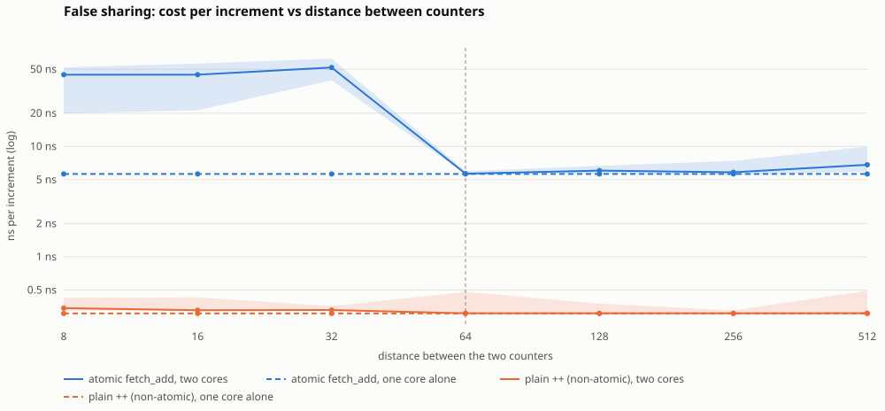

Benchmark guide: [false sharing](https://github.com/ionutneicu/os-latency-tests/blob/main/docs/benchmarks/false-sharing.md), what is measured and how to apply the result in C++.

## Design patterns

### Container memory: heap vs reserve vs pmr arenas

Build and destroy a 256-element container; cost per element (p50, shorter is better, compared with the fastest in brackets). Node containers allocate once per element, so the allocator matters far more there.

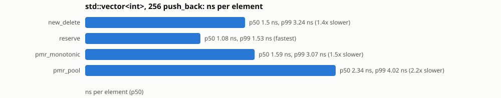

Benchmark guide: [container memory](https://github.com/ionutneicu/os-latency-tests/blob/main/docs/benchmarks/pattern-alloc.md), what is measured and how to apply the result in C++.

### Single producer / single consumer: mutex vs spinlock vs lock-free

The same bounded ring hand-off synchronised five ways. Latency is half a ping-pong round trip; throughput streams 256 Ki items through one queue.

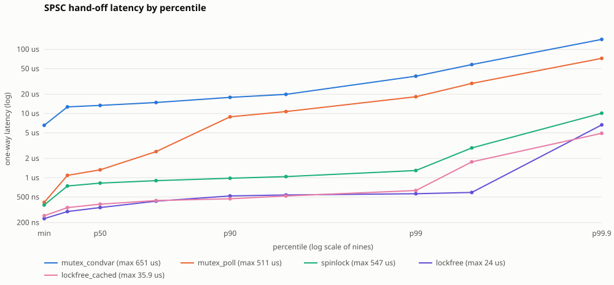

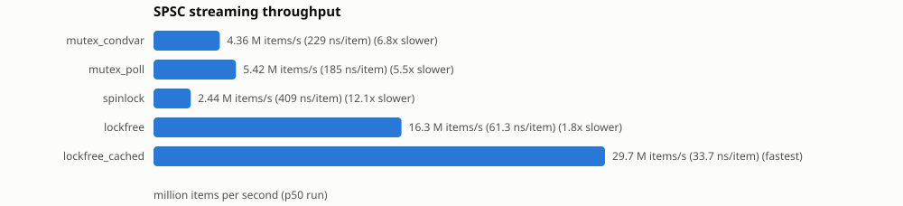

What it costs: CPU time burnt by producer plus consumer during the latency test, divided by wall time. 2.0 means both threads kept a core fully busy (polling); low values mean they slept while waiting.

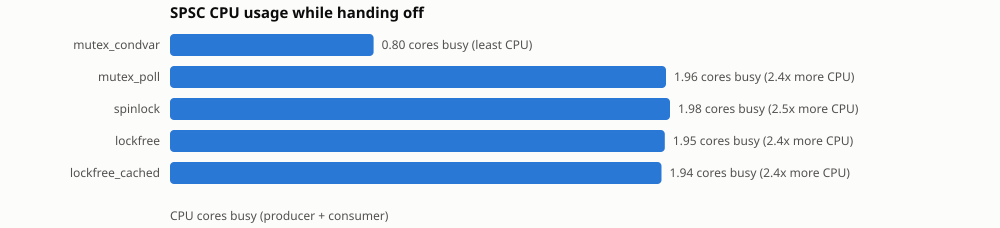

Benchmark guide: [SPSC queues](https://github.com/ionutneicu/os-latency-tests/blob/main/docs/benchmarks/pattern-spsc.md), what is measured and how to apply the result in C++.

## All latency results

Grey values have fewer than ~10 samples beyond the percentile and are not statistically reliable.

| benchmark | n | min | p50 | p90 | p99 | p99.9 | p99.99 | max |
|---|---|---|---|---|---|---|---|---|
| alloc.malloc [size=16] | 10000 | 32 ns | 34 ns | 35 ns | 40 ns | 49 ns | 229 ns | 33.9 us |
| alloc.free [size=16] | 10000 | 33 ns | 36 ns | 37 ns | 42 ns | 54 ns | 205 ns | 239 ns |
| alloc.malloc [size=64] | 10000 | 32 ns | 34 ns | 35 ns | 46 ns | 55 ns | 134 ns | 294 ns |
| alloc.free [size=64] | 10000 | 32 ns | 34 ns | 36 ns | 49 ns | 68 ns | 219 ns | 6.87 us |
| alloc.malloc [size=256] | 10000 | 32 ns | 34 ns | 35 ns | 37 ns | 61 ns | 207 ns | 209 ns |
| alloc.free [size=256] | 10000 | 32 ns | 34 ns | 35 ns | 39 ns | 64 ns | 132 ns | 33.7 us |
| alloc.malloc [size=1K] | 10000 | 32 ns | 34 ns | 37 ns | 47 ns | 73 ns | 4.41 us | 25.8 us |
| alloc.free [size=1K] | 10000 | 32 ns | 34 ns | 38 ns | 51 ns | 78 ns | 185 ns | 16.4 us |
| alloc.malloc [size=4K] | 10000 | 61 ns | 64 ns | 71 ns | 100 ns | 232 ns | 3.88 us | 15.7 us |
| alloc.free [size=4K] | 10000 | 49 ns | 52 ns | 60 ns | 78 ns | 111 ns | 284 ns | 3.29 us |
| alloc.malloc [size=16K] | 10000 | 59 ns | 62 ns | 63 ns | 88 ns | 147 ns | 295 ns | 28.6 us |
| alloc.free [size=16K] | 10000 | 49 ns | 52 ns | 53 ns | 74 ns | 91 ns | 277 ns | 5.8 us |
| alloc.malloc [size=64K] | 10000 | 58 ns | 62 ns | 64 ns | 77 ns | 105 ns | 3.68 us | 14.9 us |
| alloc.free [size=64K] | 10000 | 48 ns | 52 ns | 53 ns | 62 ns | 88 ns | 334 ns | 4.85 us |
| alloc.malloc [size=256K] | 10000 | 47 ns | 49 ns | 50 ns | 53 ns | 172 ns | 251 ns | 943 ns |
| alloc.free [size=256K] | 10000 | 46 ns | 49 ns | 50 ns | 51 ns | 60 ns | 121 ns | 4.74 us |
| alloc.malloc [size=1M] | 10000 | 47 ns | 50 ns | 63 ns | 148 ns | 299 ns | 456 ns | 5.9 us |
| alloc.free [size=1M] | 10000 | 46 ns | 49 ns | 60 ns | 73 ns | 105 ns | 206 ns | 18.8 us |
| alloc.malloc [size=4M] | 10000 | 46 ns | 48 ns | 65 ns | 181 ns | 374 ns | 14.7 us | 15.8 us |
| alloc.free [size=4M] | 10000 | 45 ns | 48 ns | 61 ns | 72 ns | 165 ns | 364 ns | 15.7 us |
| alloc.malloc [size=16M] | 10000 | 46 ns | 48 ns | 56 ns | 169 ns | 342 ns | 411 ns | 448 ns |
| alloc.free [size=16M] | 10000 | 45 ns | 48 ns | 51 ns | 69 ns | 120 ns | 254 ns | 32.3 us |
| cpu.ilp [op=int_mul, chains=1] | 15 | 0.882 ns | 0.883 ns | 0.916 ns | 1.01 ns | 1.03 ns | 1.03 ns | 1.03 ns |
| cpu.ilp [op=int_mul, chains=2] | 15 | 0.441 ns | 0.441 ns | 0.504 ns | 0.701 ns | 0.726 ns | 0.728 ns | 0.729 ns |
| cpu.ilp [op=int_mul, chains=3] | 15 | 0.294 ns | 0.294 ns | 0.335 ns | 0.367 ns | 0.37 ns | 0.37 ns | 0.37 ns |
| cpu.ilp [op=int_mul, chains=4] | 15 | 0.294 ns | 0.294 ns | 0.302 ns | 0.376 ns | 0.386 ns | 0.386 ns | 0.387 ns |
| cpu.ilp [op=int_mul, chains=6] | 15 | 0.294 ns | 0.294 ns | 0.327 ns | 0.364 ns | 0.368 ns | 0.369 ns | 0.369 ns |
| cpu.ilp [op=int_mul, chains=8] | 15 | 0.294 ns | 0.294 ns | 0.326 ns | 0.357 ns | 0.36 ns | 0.361 ns | 0.361 ns |
| cpu.ilp [op=int_mul, chains=10] | 15 | 0.294 ns | 0.296 ns | 0.32 ns | 0.342 ns | 0.345 ns | 0.346 ns | 0.346 ns |
| cpu.ilp [op=int_mul, chains=12] | 15 | 0.294 ns | 0.297 ns | 0.312 ns | 0.321 ns | 0.323 ns | 0.323 ns | 0.323 ns |
| cpu.ilp [op=int_mul, chains=16] | 15 | 0.294 ns | 0.298 ns | 0.328 ns | 0.359 ns | 0.362 ns | 0.363 ns | 0.363 ns |
| cpu.ilp [op=fp_add, chains=1] | 15 | 0.588 ns | 0.589 ns | 0.589 ns | 0.591 ns | 0.591 ns | 0.591 ns | 0.591 ns |
| cpu.ilp [op=fp_add, chains=2] | 15 | 0.294 ns | 0.294 ns | 0.31 ns | 0.357 ns | 0.363 ns | 0.363 ns | 0.363 ns |
| cpu.ilp [op=fp_add, chains=3] | 15 | 0.2 ns | 0.201 ns | 0.211 ns | 0.242 ns | 0.246 ns | 0.246 ns | 0.246 ns |
| cpu.ilp [op=fp_add, chains=4] | 15 | 0.15 ns | 0.15 ns | 0.186 ns | 0.224 ns | 0.229 ns | 0.23 ns | 0.23 ns |
| cpu.ilp [op=fp_add, chains=6] | 15 | 0.147 ns | 0.16 ns | 0.181 ns | 0.188 ns | 0.189 ns | 0.189 ns | 0.189 ns |
| cpu.ilp [op=fp_add, chains=8] | 15 | 0.164 ns | 0.166 ns | 0.192 ns | 0.204 ns | 0.204 ns | 0.205 ns | 0.205 ns |
| cpu.ilp [op=fp_add, chains=10] | 15 | 0.161 ns | 0.163 ns | 0.175 ns | 0.194 ns | 0.196 ns | 0.196 ns | 0.196 ns |
| cpu.ilp [op=fp_add, chains=12] | 15 | 0.161 ns | 0.163 ns | 0.181 ns | 0.184 ns | 0.184 ns | 0.184 ns | 0.184 ns |
| cpu.ilp [op=fp_add, chains=16] | 15 | 0.18 ns | 0.183 ns | 0.192 ns | 0.21 ns | 0.213 ns | 0.213 ns | 0.213 ns |
| cpu.ilp [op=fp_mul, chains=1] | 15 | 1.29 ns | 1.29 ns | 1.34 ns | 1.45 ns | 1.46 ns | 1.46 ns | 1.46 ns |
| cpu.ilp [op=fp_mul, chains=2] | 15 | 0.645 ns | 0.646 ns | 0.749 ns | 0.84 ns | 0.847 ns | 0.848 ns | 0.848 ns |
| cpu.ilp [op=fp_mul, chains=3] | 15 | 0.43 ns | 0.43 ns | 0.443 ns | 0.495 ns | 0.502 ns | 0.503 ns | 0.503 ns |
| cpu.ilp [op=fp_mul, chains=4] | 15 | 0.323 ns | 0.323 ns | 0.331 ns | 0.359 ns | 0.362 ns | 0.363 ns | 0.363 ns |
| cpu.ilp [op=fp_mul, chains=6] | 15 | 0.215 ns | 0.216 ns | 0.242 ns | 0.268 ns | 0.272 ns | 0.272 ns | 0.272 ns |
| cpu.ilp [op=fp_mul, chains=8] | 15 | 0.161 ns | 0.164 ns | 0.18 ns | 0.2 ns | 0.202 ns | 0.202 ns | 0.202 ns |
| cpu.ilp [op=fp_mul, chains=10] | 15 | 0.161 ns | 0.163 ns | 0.185 ns | 0.188 ns | 0.188 ns | 0.188 ns | 0.188 ns |
| cpu.ilp [op=fp_mul, chains=12] | 15 | 0.161 ns | 0.174 ns | 0.195 ns | 0.742 ns | 0.821 ns | 0.829 ns | 0.83 ns |
| cpu.ilp [op=fp_mul, chains=16] | 15 | 0.179 ns | 0.188 ns | 0.2 ns | 0.208 ns | 0.209 ns | 0.209 ns | 0.209 ns |
| cpu.ilp [op=load_l1, chains=1] | 15 | 1.61 ns | 1.61 ns | 1.69 ns | 1.77 ns | 1.77 ns | 1.77 ns | 1.77 ns |
| cpu.ilp [op=load_l1, chains=2] | 15 | 0.806 ns | 0.807 ns | 0.866 ns | 0.936 ns | 0.942 ns | 0.943 ns | 0.943 ns |
| cpu.ilp [op=load_l1, chains=3] | 15 | 0.538 ns | 0.538 ns | 0.58 ns | 0.611 ns | 0.613 ns | 0.613 ns | 0.613 ns |
| cpu.ilp [op=load_l1, chains=4] | 15 | 0.368 ns | 0.403 ns | 0.463 ns | 0.502 ns | 0.507 ns | 0.507 ns | 0.507 ns |
| cpu.ilp [op=load_l1, chains=6] | 15 | 0.245 ns | 0.245 ns | 0.25 ns | 0.268 ns | 0.27 ns | 0.27 ns | 0.27 ns |
| cpu.ilp [op=load_l1, chains=8] | 15 | 0.189 ns | 0.202 ns | 0.218 ns | 0.228 ns | 0.229 ns | 0.229 ns | 0.229 ns |
| cpu.ilp [op=load_l1, chains=10] | 15 | 0.186 ns | 0.188 ns | 0.2 ns | 0.205 ns | 0.205 ns | 0.205 ns | 0.205 ns |
| cpu.ilp [op=load_l1, chains=12] | 15 | 0.178 ns | 0.178 ns | 0.191 ns | 0.195 ns | 0.196 ns | 0.196 ns | 0.196 ns |
| cpu.ilp [op=load_l1, chains=16] | 15 | 0.171 ns | 0.171 ns | 0.181 ns | 0.185 ns | 0.186 ns | 0.186 ns | 0.186 ns |
| cpu.ilp [op=load_mem, chains=1] | 15 | 170 ns | 190 ns | 298 ns | 336 ns | 337 ns | 337 ns | 337 ns |
| cpu.ilp [op=load_mem, chains=2] | 15 | 87.9 ns | 91.7 ns | 98.5 ns | 138 ns | 144 ns | 144 ns | 144 ns |
| cpu.ilp [op=load_mem, chains=3] | 15 | 57.1 ns | 62.5 ns | 75.5 ns | 85.5 ns | 86.4 ns | 86.5 ns | 86.5 ns |
| cpu.ilp [op=load_mem, chains=4] | 15 | 42.9 ns | 45.1 ns | 48.8 ns | 52.5 ns | 52.9 ns | 52.9 ns | 52.9 ns |
| cpu.ilp [op=load_mem, chains=6] | 15 | 29.2 ns | 30.7 ns | 36 ns | 39.8 ns | 40.2 ns | 40.2 ns | 40.2 ns |
| cpu.ilp [op=load_mem, chains=8] | 15 | 22.2 ns | 23 ns | 25.8 ns | 27.7 ns | 27.9 ns | 28 ns | 28 ns |
| cpu.ilp [op=load_mem, chains=10] | 15 | 17.7 ns | 19.1 ns | 19.5 ns | 19.8 ns | 19.8 ns | 19.8 ns | 19.8 ns |
| cpu.ilp [op=load_mem, chains=12] | 15 | 15.6 ns | 16.3 ns | 16.5 ns | 17.3 ns | 17.4 ns | 17.4 ns | 17.4 ns |
| cpu.ilp [op=load_mem, chains=16] | 15 | 14.7 ns | 15.2 ns | 15.7 ns | 16 ns | 16.1 ns | 16.1 ns | 16.1 ns |
| multicore.false_sharing_alone [op=plain, cpu_a=3, cpu_b=0] | 15 | 0.296 ns | 0.326 ns | 0.354 ns | 0.356 ns | 0.356 ns | 0.356 ns | 0.356 ns |
| multicore.false_sharing [op=plain, distance=8, cpu_a=3, cpu_b=0] | 15 | 0.351 ns | 0.373 ns | 0.451 ns | 0.538 ns | 0.545 ns | 0.546 ns | 0.546 ns |
| multicore.false_sharing [op=plain, distance=16, cpu_a=3, cpu_b=0] | 15 | 0.352 ns | 0.391 ns | 1.02 ns | 1.47 ns | 1.51 ns | 1.52 ns | 1.52 ns |
| multicore.false_sharing [op=plain, distance=32, cpu_a=3, cpu_b=0] | 15 | 0.351 ns | 0.367 ns | 0.416 ns | 0.436 ns | 0.437 ns | 0.437 ns | 0.437 ns |
| multicore.false_sharing [op=plain, distance=64, cpu_a=3, cpu_b=0] | 15 | 0.297 ns | 0.303 ns | 0.622 ns | 1.04 ns | 1.07 ns | 1.07 ns | 1.07 ns |
| multicore.false_sharing [op=plain, distance=128, cpu_a=3, cpu_b=0] | 15 | 0.324 ns | 0.354 ns | 0.382 ns | 0.513 ns | 0.531 ns | 0.533 ns | 0.534 ns |
| multicore.false_sharing [op=plain, distance=256, cpu_a=3, cpu_b=0] | 15 | 0.315 ns | 0.351 ns | 0.355 ns | 0.4 ns | 0.406 ns | 0.407 ns | 0.407 ns |
| multicore.false_sharing [op=plain, distance=512, cpu_a=3, cpu_b=0] | 15 | 0.297 ns | 0.324 ns | 0.626 ns | 0.841 ns | 0.846 ns | 0.846 ns | 0.846 ns |
| multicore.false_sharing_alone [op=atomic, cpu_a=3, cpu_b=0] | 15 | 5.3 ns | 5.41 ns | 5.69 ns | 5.74 ns | 5.74 ns | 5.74 ns | 5.74 ns |
| multicore.false_sharing [op=atomic, distance=8, cpu_a=3, cpu_b=0] | 15 | 23.7 ns | 28.3 ns | 29.7 ns | 30.3 ns | 30.4 ns | 30.4 ns | 30.4 ns |
| multicore.false_sharing [op=atomic, distance=16, cpu_a=3, cpu_b=0] | 15 | 24.9 ns | 29.3 ns | 30.3 ns | 30.9 ns | 30.9 ns | 31 ns | 31 ns |
| multicore.false_sharing [op=atomic, distance=32, cpu_a=3, cpu_b=0] | 15 | 32.8 ns | 35.3 ns | 37.2 ns | 37.9 ns | 38 ns | 38 ns | 38 ns |
| multicore.false_sharing [op=atomic, distance=64, cpu_a=3, cpu_b=0] | 15 | 7.38 ns | 7.44 ns | 7.73 ns | 8.12 ns | 8.17 ns | 8.17 ns | 8.17 ns |
| multicore.false_sharing [op=atomic, distance=128, cpu_a=3, cpu_b=0] | 15 | 7.35 ns | 7.44 ns | 7.65 ns | 7.69 ns | 7.7 ns | 7.7 ns | 7.7 ns |
| multicore.false_sharing [op=atomic, distance=256, cpu_a=3, cpu_b=0] | 15 | 6.89 ns | 7.12 ns | 11.9 ns | 18.7 ns | 19.2 ns | 19.3 ns | 19.3 ns |
| multicore.false_sharing [op=atomic, distance=512, cpu_a=3, cpu_b=0] | 15 | 6.81 ns | 7 ns | 7.65 ns | 8.5 ns | 8.59 ns | 8.6 ns | 8.61 ns |
| multicore.c2c_latency [cpu_a=0, cpu_b=1] | 15 | 63.7 ns | 65.2 ns | 76.9 ns | 87.3 ns | 88 ns | 88 ns | 88 ns |
| multicore.c2c_latency [cpu_a=0, cpu_b=2] | 15 | 59.1 ns | 62.6 ns | 69.1 ns | 78 ns | 78.9 ns | 79 ns | 79 ns |
| multicore.c2c_latency [cpu_a=0, cpu_b=3] | 15 | 70.4 ns | 74 ns | 87.5 ns | 98.1 ns | 99.4 ns | 99.5 ns | 99.6 ns |
| multicore.c2c_latency [cpu_a=1, cpu_b=2] | 15 | 61.5 ns | 63.9 ns | 92.1 ns | 126 ns | 130 ns | 131 ns | 131 ns |
| multicore.c2c_latency [cpu_a=1, cpu_b=3] | 15 | 69.6 ns | 78.5 ns | 960 ns | 1.26 us | 1.3 us | 1.3 us | 1.31 us |
| multicore.c2c_latency [cpu_a=2, cpu_b=3] | 15 | 69.6 ns | 72 ns | 195 ns | 471 ns | 501 ns | 504 ns | 504 ns |
| pattern.alloc_vector [allocator=new_delete] | 10000 | 1.47 ns | 1.5 ns | 1.67 ns | 3.24 ns | 17.6 ns | 60.4 ns | 70.3 ns |
| pattern.alloc_vector [allocator=reserve] | 10000 | 1.07 ns | 1.08 ns | 1.09 ns | 1.53 ns | 2.59 ns | 58.2 ns | 70.8 ns |
| pattern.alloc_vector [allocator=pmr_monotonic] | 10000 | 1.3 ns | 1.59 ns | 2.79 ns | 3.07 ns | 14.2 ns | 44.5 ns | 56.7 ns |
| pattern.alloc_vector [allocator=pmr_pool] | 10000 | 1.79 ns | 2.34 ns | 3.37 ns | 4.02 ns | 21.7 ns | 60.7 ns | 65.1 ns |
| pattern.alloc_list [allocator=new_delete] | 10000 | 27.6 ns | 30.5 ns | 38.4 ns | 76.3 ns | 222 ns | 608 ns | 792 ns |
| pattern.alloc_list [allocator=pmr_monotonic] | 10000 | 6.01 ns | 9.41 ns | 10 ns | 11.3 ns | 101 ns | 269 ns | 296 ns |
| pattern.alloc_list [allocator=pmr_pool] | 10000 | 17.9 ns | 20.7 ns | 36.1 ns | 69.5 ns | 215 ns | 825 ns | 1.3 us |
| pattern.spsc_latency [queue=mutex_condvar] | 10000 | 5.4 us | 11.8 us | 13.5 us | 26.7 us | 77.2 us | 488 us | 1.72 ms |
| pattern.spsc_throughput [queue=mutex_condvar] | 15 | 187 ns | 228 ns | 270 ns | 277 ns | 278 ns | 278 ns | 278 ns |
| pattern.spsc_latency [queue=mutex_poll] | 10000 | 211 ns | 880 ns | 1.12 us | 2.88 us | 14 us | 89.1 us | 184 us |
| pattern.spsc_throughput [queue=mutex_poll] | 15 | 182 ns | 236 ns | 282 ns | 303 ns | 306 ns | 306 ns | 306 ns |
| pattern.spsc_latency [queue=spinlock] | 10000 | 150 ns | 480 ns | 619 ns | 845 ns | 14 us | 234 us | 248 us |
| pattern.spsc_throughput [queue=spinlock] | 15 | 112 ns | 125 ns | 151 ns | 164 ns | 166 ns | 166 ns | 166 ns |
| pattern.spsc_latency [queue=lockfree] | 10000 | 172 ns | 235 ns | 273 ns | 330 ns | 2.14 us | 6.35 us | 9.08 us |
| pattern.spsc_throughput [queue=lockfree] | 15 | 13.7 ns | 15.3 ns | 17.1 ns | 17.8 ns | 17.9 ns | 17.9 ns | 17.9 ns |
| pattern.spsc_latency [queue=lockfree_cached] | 10000 | 170 ns | 219 ns | 250 ns | 276 ns | 2.17 us | 8.41 us | 73.5 us |
| pattern.spsc_throughput [queue=lockfree_cached] | 15 | 43.7 ns | 56.1 ns | 66.6 ns | 78.1 ns | 79.8 ns | 79.9 ns | 79.9 ns |
| sync.mutex_wakeup | 10000 | 10.5 us | 30 us | 51.4 us | 102 us | 1.31 ms | 2.08 ms | 2.09 ms |
| sync.condvar_wakeup | 10000 | 8.23 us | 26.9 us | 50.6 us | 103 us | 448 us | 2.07 ms | 2.12 ms |
| thread.create_to_start | 10000 | 4.48 us | 7.33 us | 11.8 us | 100 us | 276 us | 1.3 ms | 2.02 ms |
| thread.exit_to_join | 10000 | 3.37 us | 4.96 us | 5.67 us | 15.7 us | 69.4 us | 434 us | 1.96 ms |

*Generated from results.json by tools/olt-report.py. An interactive version with hover details is in report.html next to this file.*
